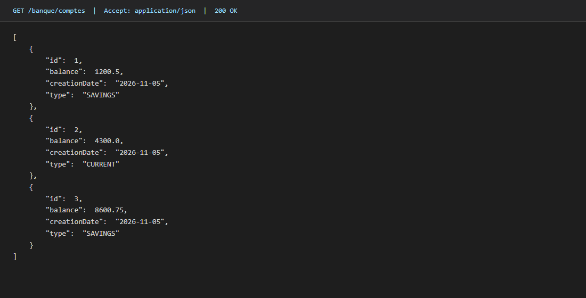
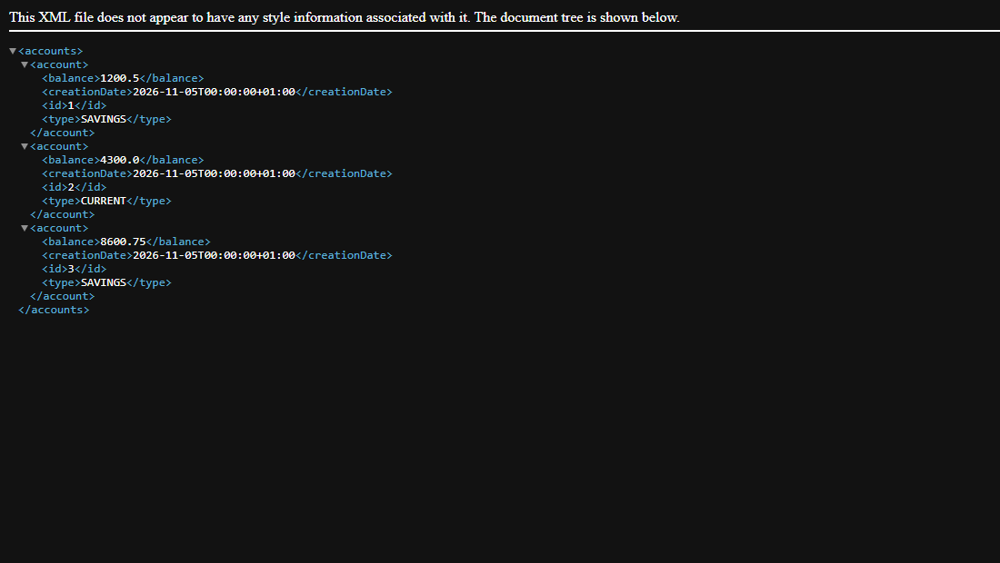

# J2E-TP7 — JAX-RS / Jersey

TP 7 du cours *Architecture Microservices* — API REST de comptes bancaires avec **JAX-RS (Jersey)** sur Spring Boot, qui répond en **JSON et XML**.

## JSON



## XML



## Stack

`Java 17` · `Spring Boot 3.2` · `Jersey 3.1` (JAX-RS) · `JAXB` · `H2` · `Lombok`

## Lancer

```bash
mvn spring-boot:run   # http://localhost:8082
mvn test
```

Console H2 : <http://localhost:8082/h2-console> (`jdbc:h2:mem:banque`, user `sa`)

## Endpoints

| Méthode | URL | Résultat |
|---|---|---|
| GET | `/banque/comptes` | 200 (JSON ou XML) |
| GET | `/banque/comptes/{id}` | 200 / 404 |
| POST | `/banque/comptes` | 201 |
| PUT | `/banque/comptes/{id}` | 200 / 404 |
| DELETE | `/banque/comptes/{id}` | 204 / 404 |
| GET | `/banque/comptes/stats` | total comptes + solde |

```bash
curl -X GET "http://localhost:8082/banque/comptes" -H "Accept: application/json"
curl -X GET "http://localhost:8082/banque/comptes" -H "Accept: application/xml"
```

## Architecture

```
web/         AccountRestJaxRsApi   @Path("/banque"), @GET/@POST/@PUT/@DELETE
entities/    Account (@XmlRootElement), AccountType
repositories/AccountRepository
config/      JerseyConfig (ResourceConfig), DataInitializer
```

Le format de réponse dépend uniquement de l'en-tête `Accept` :
`@Produces({APPLICATION_JSON, APPLICATION_XML})`.

**Tests : 7/7** — `AccountRestJaxRsApiTest`, qui vérifie JSON, XML, CRUD et 404 sur une vraie instance HTTP.

Auteur : [zAK4-7](https://github.com/zAK4-7)
